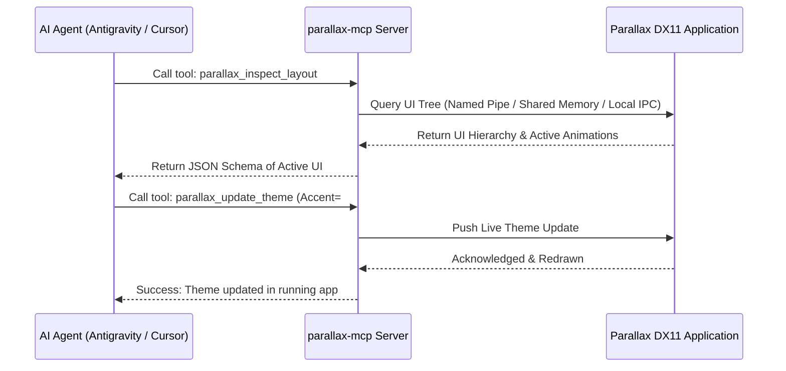

# Parallax MCP Server Specification & Architecture Roadmap

> **Status:** Planned & Reserved for Subsequent Phase  
> **Target Ecosystem:** Model Context Protocol (MCP) Server for Parallax UI Framework (`parallax-mcp`)  
> **Integrations:** Antigravity CLI, Cursor, Windsurf, Claude Desktop, VS Code  

---

## 1. Vision & Purpose

The **Parallax MCP Server** (`parallax-mcp`) will provide a real-time introspection, live-theming, code-scaffolding, and visual verification bridge between AI coding agents and running Parallax DirectX 11 applications.

By exposing an MCP interface, developers and AI pair programmers will be able to:
1. Inspect running UI widget hierarchies, layout bounds, and active animation states in real time.
2. Query and search across the built-in 2,077 SVG icon library with fuzzy matching and category filters.
3. Live-tweak color tokens, spring physics constants (`stiffness`, `damping`), and cubic bezier curves on the fly without recompilation.
4. Capture annotated UI snapshots directly from the DirectX 11 render target for automated visual regression auditing.
5. Scaffold production-grade C++20 Parallax layouts and tabs directly into codebases.

---

## 2. Planned MCP Tool Definitions

### 2.1 UI Inspection & Control (`parallax_ui_*`)
- **`parallax_inspect_layout`**
  - **Description:** Retrieve the active window hierarchy, docking side, active tab/sub-tab, and widget bounding rectangles.
  - **Parameters:** `window_id` (optional string).
  - **Returns:** JSON tree of elements, positions, sizes, and hover/active states.

- **`parallax_trigger_action`**
  - **Description:** Programmatically simulate UI interactions for automated testing or agent verification.
  - **Parameters:** `action` (`"toggle_menu"`, `"select_tab"`, `"click_widget"`, `"set_input_text"`), `target_id` (string), `value` (optional string/number).

- **`parallax_capture_viewport`**
  - **Description:** Capture the current DirectX 11 swapchain backbuffer and return a base64 PNG image or save to disk, optionally drawing bounding boxes around active widgets.
  - **Parameters:** `annotated` (boolean), `output_path` (optional string).

### 2.2 Live Theming & Motion Tuning (`parallax_theme_*`)
- **`parallax_get_theme`**
  - **Description:** Retrieve the active color palette (Background, Surface, Accent, Text, Borders) and animation parameters.
- **`parallax_update_theme`**
  - **Description:** Dynamically push updated hex colors, corner radii, or spacing to the running application via shared memory or local socket.
- **`parallax_tune_spring`**
  - **Description:** Adjust spring physics parameters (`stiffness`, `damping`, `mass`) or cubic bezier control points in real time to audition micro-motion feel.

### 2.3 Icon Discovery & Asset Helper (`parallax_icons_*`)
- **`parallax_search_icons`**
  - **Description:** Fuzzy search the 2,077 Lucide SVG icon collection by keyword, tags, or name (e.g. `"security"`, `"settings"`, `"arrow"`).
  - **Parameters:** `query` (string), `limit` (integer, default 20).
  - **Returns:** List of matching icon names, SVG file paths, and ready-to-use C++ snippets (`Parallax::Icon("shield")`).

- **`parallax_preview_icon`**
  - **Description:** Render a requested SVG icon at a specified DPI scale and return image data or SVG markup.

### 2.4 Code Scaffolding (`parallax_scaffold_*`)
- **`parallax_scaffold_tab`**
  - **Description:** Generate boilerplate C++20 code for a new Parallax tab featuring responsive 2/3 column groupbox grids, inputs, and toggles adhering to C++ Core Guidelines and design taste rules.

---

## 3. Communication Architecture

---

## 4. Implementation Phasing
- **Phase 1 (Current):** Core UI library, DX11 host, LunaSVG icon pipeline, animations, layout shell, standalone demo, local web documentation.
- **Phase 2:** Advanced widget primitives (sliders, color pickers, custom graphs, segmented switches, modal dialogs).
- **Phase 3:** `parallax-mcp` standalone binary / Node / Python package connecting via IPC (Windows Named Pipe `\\.\pipe\parallax_ipc`).
