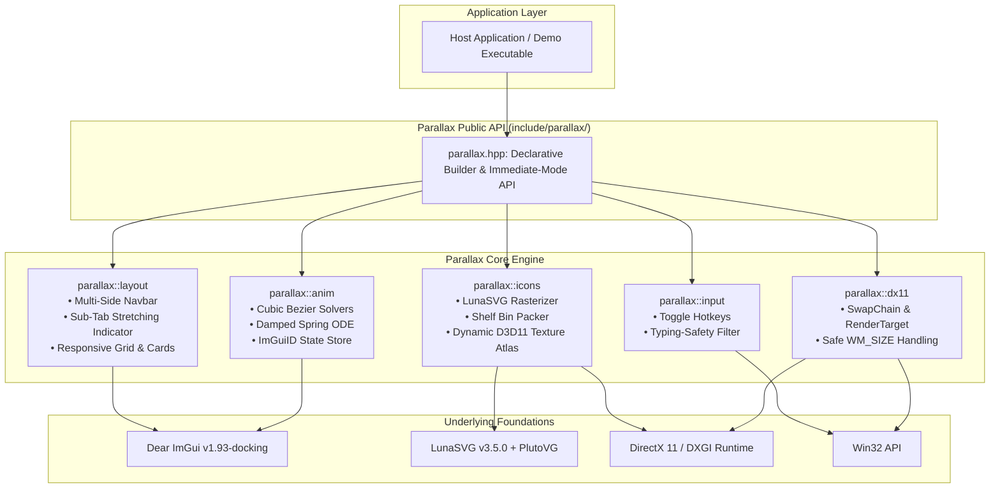

# Implementation Plan - Phase 1: Parallax UI Library
## Core Architecture, DX11 Backend, SVG Engine & Layout System

**Library:** Parallax (`parallax-imgui`)  
**Standard:** C++20  
**Graphics API:** DirectX 11 + Dear ImGui  
**Scope:** Strictly UI/UX only (zero game memory/cheat functions)

---

## 1. Executive Summary & Goals

The goal of Phase 1 is to build the core production-ready architecture for **Parallax** (`parallax-imgui`), a modern, high-performance C++20 UI library. Parallax delivers:
- Studio-grade aesthetics with calibrated dark zinc palettes, crisp 1px borders, and refined hierarchy.
- Frame-rate independent physics-driven motion (damped springs and cubic bezier curves).
- An on-demand 2,077 SVG icon pipeline powered by LunaSVG, packing icons dynamically into a DirectX 11 Texture Atlas as high-precision alpha masks.
- A fully configurable window shell supporting 4-sided navigation bar docks (`Left`, `Right`, `Top`, `Bottom`), animated stretching sub-tab indicators, 3 window size tiers (`Compact`, `Standard`, `Expanded`), responsive groupbox grids, global search bar, and user profile card.
- A standalone Win32 + DirectX 11 test harness with typing-safe hotkeys (`VK_RSHIFT`, `VK_INSERT`).

---

## 2. Architecture Diagram



---

## 3. Detailed Component Breakdown

### 3.1 Project Structure & Build System
```
parallax-imgui/
├── CMakeLists.txt
├── include/
│   └── parallax/
│       ├── parallax.hpp           // Unified header & API entry
│       ├── core/
│       │   ├── types.hpp          // Vec2, Vec4, Color, SizeTier, NavSide
│       │   ├── context.hpp        // Global Parallax runtime context
│       │   └── style.hpp          // Color tokens, metrics & theme settings
│       ├── anim/
│       │   ├── easing.hpp         // Cubic Bezier solver & standard presets
│       │   ├── spring.hpp         // Damped harmonic spring physics
│       │   └── manager.hpp        // Animation state store per ImGuiID
│       ├── icons/
│       │   ├── icon_atlas.hpp     // Dynamic D3D11 Texture Atlas & shelf packer
│       │   └── icon_loader.hpp    // LunaSVG on-demand rasterizer & alpha processor
│       ├── layout/
│       │   ├── window.hpp         // Window shell, size tiers & corner resize
│       │   ├── navbar.hpp         // 4-side dock & sliding pill indicator
│       │   ├── tabs.hpp           // Sub-tabs & stretching spring indicator
│       │   ├── grid.hpp           // Responsive 1/2/3 column layout & groupboxes
│       │   └── profile_card.hpp   // User profile card slot & header search bar
│       ├── input/
│       │   └── hotkeys.hpp        // Input handler, toggle keys, typing safety
│       └── dx11/
│           └── d3d11_host.hpp     // SwapChain, render target & safe resize
├── src/
│   ├── core/
│   │   ├── context.cpp
│   │   └── style.cpp
│   ├── anim/
│   │   ├── easing.cpp
│   │   ├── spring.cpp
│   │   └── manager.cpp
│   ├── icons/
│   │   ├── icon_atlas.cpp
│   │   └── icon_loader.cpp
│   ├── layout/
│   │   ├── window.cpp
│   │   ├── navbar.cpp
│   │   ├── tabs.cpp
│   │   ├── grid.cpp
│   │   └── profile_card.cpp
│   ├── input/
│   │   └── hotkeys.cpp
│   ├── dx11/
│   │   └── d3d11_host.cpp
│   └── parallax.cpp               // High-level API & Builder implementation
├── examples/
│   └── demo_dx11/
│       └── main.cpp               // Standalone DirectX 11 demo executable
└── icons/                         // 2,077 SVG icon library
```

- **CMake Configuration**:
  - Targets C++20 (`CMAKE_CXX_STANDARD 20`, `CMAKE_CXX_STANDARD_REQUIRED ON`).
  - Sets MSVC flags: `/W4`, `/utf-8`, `/permissive-`, `/Zc:__cplusplus`, `/MP`.
  - Automatically fetches `imgui` (v1.93.0-docking) and `lunasvg` (v3.5.0 with `GIT_SUBMODULES_RECURSE TRUE` to bundle plutovg).
  - Produces static library `parallax` and executable `parallax_demo_dx11`.

---

### 3.2 DirectX 11 Host & Input Handling
- **D3D11 Host**:
  - Encapsulates device, immediate context, swap chain, and render target view.
  - Can operate standalone (creating its own Win32 window) or attach to an existing `ID3D11Device*` / `Present` hook.
  - Robust `WM_SIZE` handling: releases RTV before calling `ResizeBuffers`, then recreates RTV and updates viewport.
- **Input & Typing Safety**:
  - Menu toggle hotkeys default to **Right Shift** (`VK_RSHIFT`) and **Insert** (`VK_INSERT`).
  - **Typing Safety Rule**: When any ImGui text input widget is active (`ImGui::GetIO().WantTextInput == true`), `VK_RSHIFT` is suppressed so users can type uppercase characters freely without closing the window.
  - Rebindable via `parallax::input::SetToggleKeys(...)`.

---

### 3.3 Animation & Easing Engine (`parallax::anim`)
- **Cubic Bezier Easing**:
  - Inverts $x(t) = \text{progress}$ using Newton-Raphson with binary search fallback.
  - Presets: `EaseOutQuart`, `EaseOutQuint`, `EaseOutExpo`, `EaseInOutStandard`, `SheetStandard`.
- **Damped Spring Physics**:
  - Analytical second-order harmonic oscillator ($m \ddot{x} + c \dot{x} + k(x - x_t) = 0$).
  - Default preset: `stiffness: 100.0f, damping: 20.0f` for natural, weighted transitions.
- **Window Transitions**:
  - Smooth open/close: scale from 92% to 100% and alpha fade from 0.0 to 1.0.
  - Global speed multiplier: `Fast` (1.5x), `Normal` (1.0x), `Relaxed` (0.7x), `Off` (instant, reduced motion).

---

### 3.4 On-Demand 2,077 SVG Icon Pipeline (`parallax::icons`)
- **Lazy Loading**:
  - Icons are rasterized only when requested (`Parallax::Icon("shield")`).
  - Files searched in `./icons/`, `../icons/`, `./assets/icons/`, and application root.
  - Missing file fallback: embedded geometric shield icon ensures zero crashes.
- **LunaSVG Rasterization**:
  - Rasterizes at current display DPI scale.
  - Normalizes `stroke="currentColor"` to full white `#FFFFFF`.
- **Alpha Mask Conversion**:
  - Monotone stroke icons converted to pure white RGB with coverage alpha ($R=255, G=255, B=255, A=\text{coverage}$).
  - Allows Dear ImGui `ImGui::Image(..., tint_col)` to tint the icon to any color dynamically with crisp subpixel antialiasing.
  - Optional `preserve_colors = true` for full-color SVGs (swaps BGRA to RGBA).
- **Dynamic D3D11 Texture Atlas**:
  - Shelf bin packer allocates rects in horizontal rows.
  - Subregions uploaded directly via `ID3D11DeviceContext::UpdateSubresource`.
  - Automatically doubles texture size and re-packs if capacity is reached.

---

### 3.5 Multi-Side, Multi-Size Layout Engine (`parallax::layout`)
- **Navigation Bar Dock Sides**:
  - `NavSide::Left`: Vertical sidebar with brand logo, tab list, and bottom user profile card.
  - `NavSide::Right`: Mirrored vertical sidebar.
  - `NavSide::Top`: Horizontal top navbar with brand logo, horizontal tabs, and right header profile card.
  - `NavSide::Bottom`: Horizontal bottom dock bar.
- **Sub-Tabs with Stretching Spring Indicator**:
  - Placements: `TopHorizontal`, `BottomHorizontal`, `NestedSidebar`.
  - Active line indicator smoothly stretches toward target tab before snapping into position using spring physics.
- **Window Size Tiers & Resizing**:
  - Tiers: `Compact` (720x480), `Standard` (900x600), `Expanded` (1080x720).
  - Smooth animated tier transitions plus interactive corner drag resizing with minimum bounds (640x440).
- **Responsive Content Grid**:
  - 1, 2, and 3-column groupbox layouts.
  - Dark zinc cards (`#16181F`) with 1px subtle borders (`#FFFFFF10`) and clean padding.
- **Header & Profile Slots**:
  - Header search bar with animated focus ring and query callback.
  - User profile card with avatar, username, and status dot.

---

### 3.6 Standalone Demo (`examples/demo_dx11/main.cpp`)
- Complete runnable application showcasing:
  1. Window open/close toggle via **Right Shift** and **Insert**.
  2. Typing safety verification with active input fields.
  3. Live navigation side switching (`Left`, `Right`, `Top`, `Bottom`).
  4. Live window size tier switching (`Compact`, `Standard`, `Expanded`).
  5. Smooth sub-tab stretching indicators.
  6. On-demand SVG icons rasterized into D3D11 atlas with dynamic tinting.
  7. Responsive 1, 2, and 3-column groupbox grids with interactive controls.
  8. Animation speed multiplier settings (`Fast`, `Normal`, `Relaxed`, `Off`).

---

## 4. Verification Plan

### Automated Build Verification
```powershell
cmake -B build -A x64
cmake --build build --config Release
```
- Verify zero compiler errors and zero compiler warnings.
- Verify `parallax.lib` and `parallax_demo_dx11.exe` are generated.

### Manual Feature Verification
1. Run `.\build\examples\demo_dx11\Release\parallax_demo_dx11.exe`.
2. Toggle menu using `VK_RSHIFT` and `VK_INSERT`: verify smooth scale (92% to 100%) and alpha fade.
3. Test typing safety: click inside the search bar, type capital letters with `Right Shift`, verify the menu stays open.
4. Test live navbar side switching: change between Left, Right, Top, and Bottom.
5. Test sub-tabs: click between tabs, verify stretching spring active indicator.
6. Test icon rendering: verify multiple SVG icons render crisp at native DPI with proper tinting.
